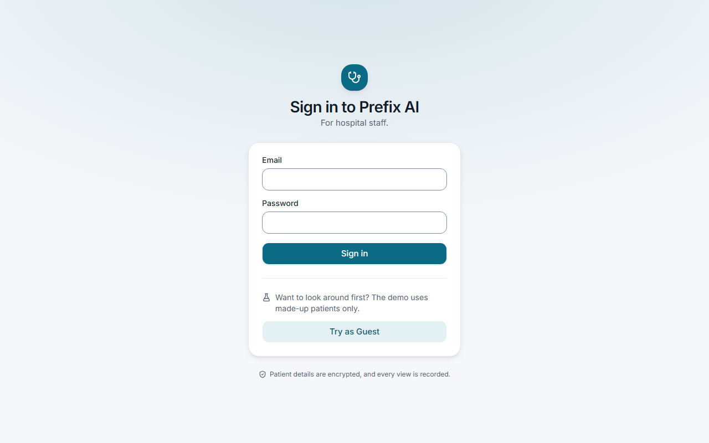
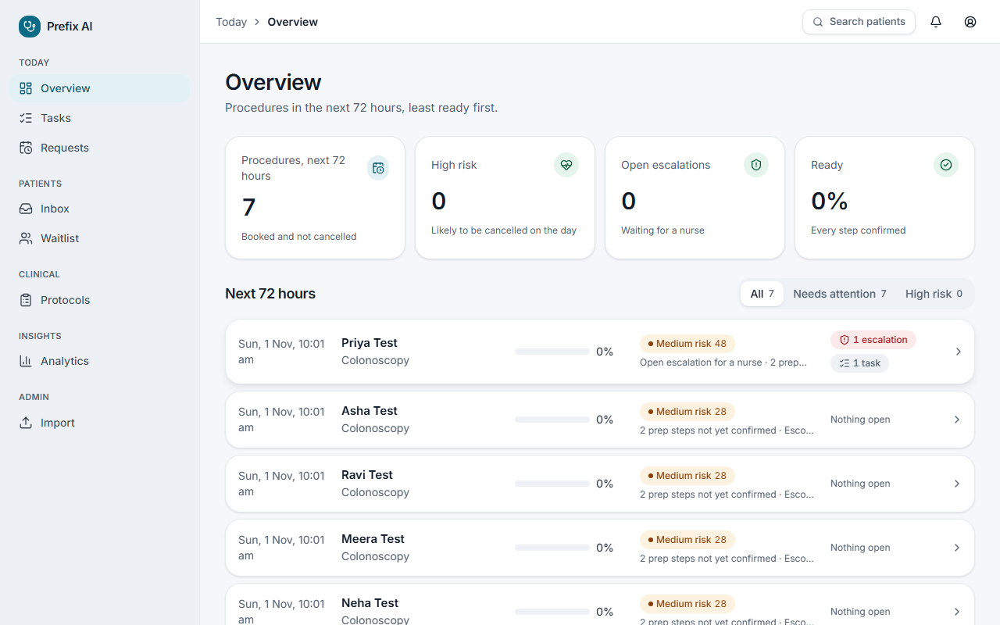
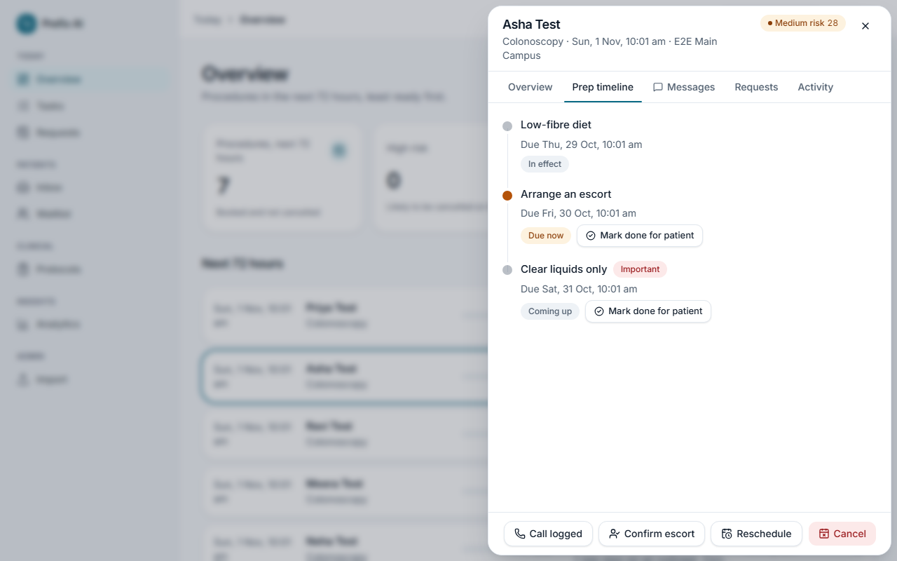
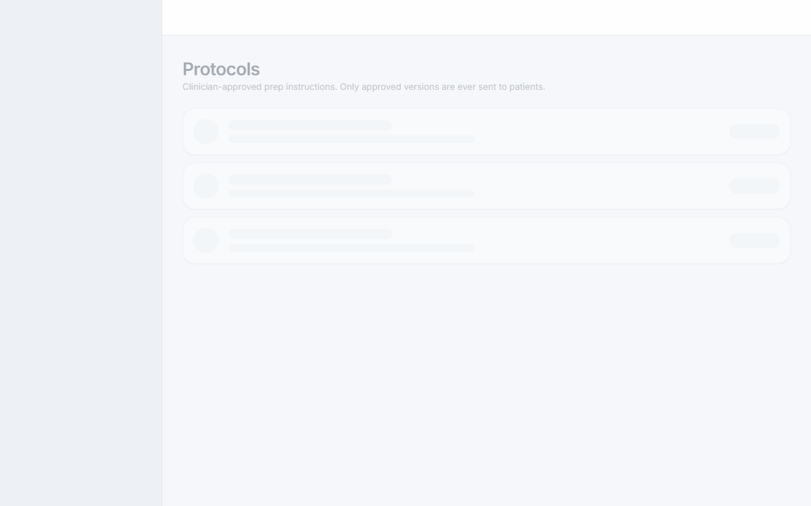
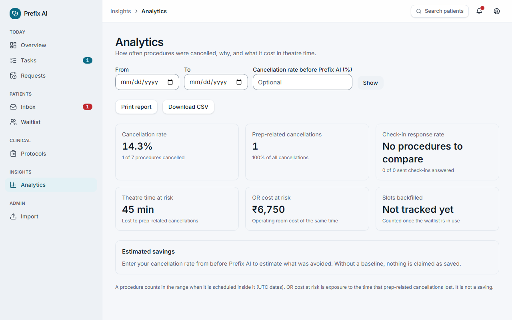
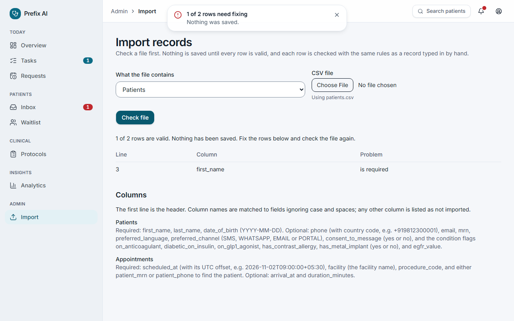
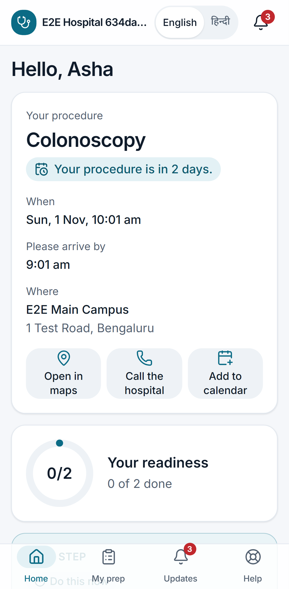
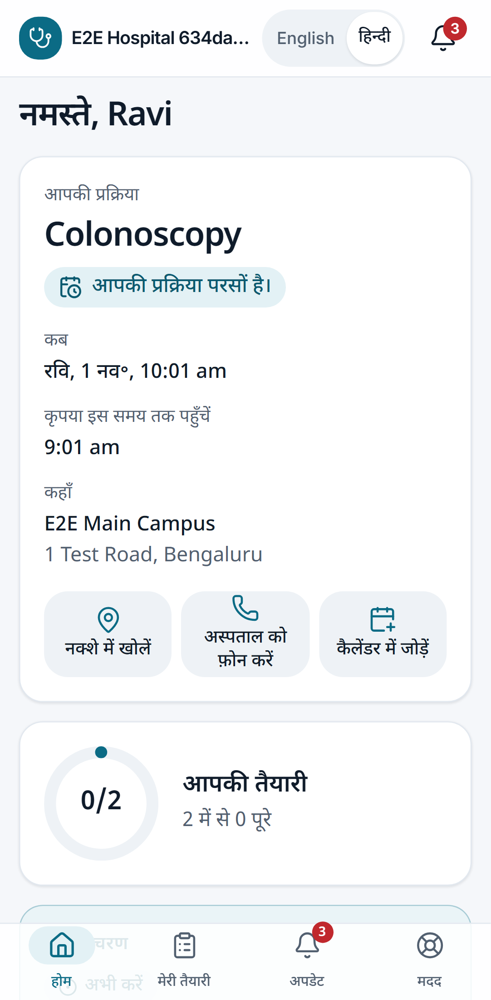
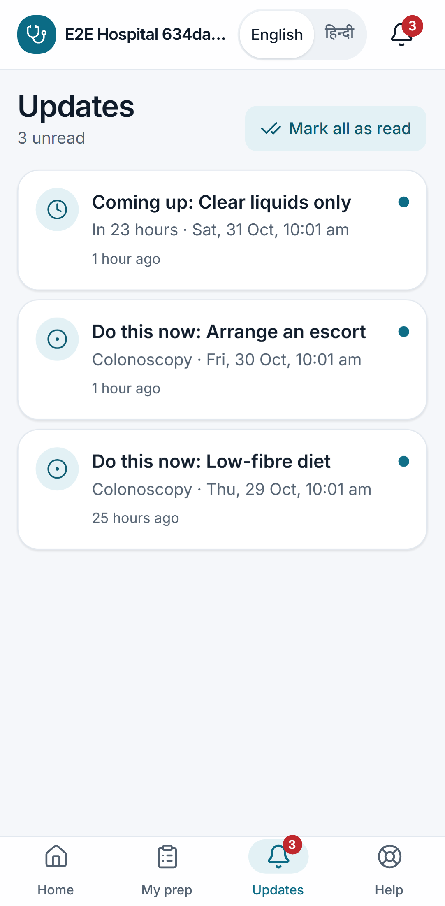
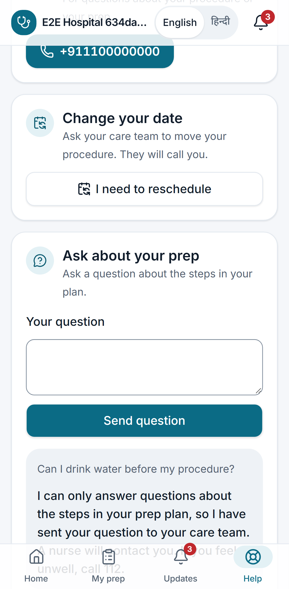

# Prefix AI

Prefix AI prevents last-minute cancellations of surgeries, colonoscopies, and imaging scans caused by improper patient preparation. See [CLAUDE.md](CLAUDE.md) for the mission, features, and safety rules, and [docs/ARCHITECTURE.md](docs/ARCHITECTURE.md) for the system design.

## Quick start

Run the whole app on your own machine, without Docker. Run these from the repository root. The Windows variants and troubleshooting are in [docs/LOCAL_DEV.md](docs/LOCAL_DEV.md).

```bash
corepack enable                  # pnpm 12 (Windows without admin: corepack enable --install-directory "$env:APPDATA\npm")
uv sync                          # Python 3.14 and the API packages (install uv first)
pnpm install                     # JavaScript packages
cp .env.example .env             # Windows PowerShell: Copy-Item .env.example .env
uv run --no-project --python 3.12 --with pgserver python scripts/dev_postgres.py   # PostgreSQL on port 55432
uv run alembic -c apps/api/alembic.ini upgrade head
uv run python -m prefix_api.seed_demo                            # demo hospital; prints the demo admin password the first time
uv run uvicorn prefix_api.main:create_app --factory --port 8000  # terminal 1: the API
pnpm dev                                                         # terminal 2: the web app, then open http://localhost:3000
```

**Sign in as a guest:** open http://localhost:3000/login and press **Try as Guest**. No password is needed. The demo admin is `admin@guest-demo-hospital.demo.example.com`, with the password printed by `seed_demo`.

With Docker instead, run `make up`, `make migrate` and `make seed-demo`.

## Repository layout

```
apps/
  api/        FastAPI service (Python, SQLAlchemy 2, Alembic, Pydantic v2)
  worker/     Celery worker + beat (Python, Redis broker); reuses prefix_api code
  web/        Next.js App Router frontend (TypeScript, Tailwind CSS, shadcn/ui)
packages/
  shared/     TypeScript types shared with the web app (to be generated from the API's OpenAPI schema)
docs/         Architecture notes
```

Two package managers share the repo:

- **pnpm workspace** (`pnpm-workspace.yaml`) for the JavaScript packages: `apps/web` and `packages/*`.
- **uv workspace** (root `pyproject.toml`) for the Python packages: `apps/api` and `apps/worker`, with one lockfile (`uv.lock`).

Run every command from the repository root.

## Prerequisites

| Tool | Version | Used for |
|---|---|---|
| [Docker Desktop](https://docs.docker.com/get-docker/) (Compose v2) | latest | Running the full stack |
| [uv](https://docs.astral.sh/uv/getting-started/installation/) | 0.13+ | Python 3.14 and Python dependencies |
| [Node.js](https://nodejs.org/) | 24 LTS | Web app |
| pnpm | 12 (pinned in `package.json`) | Enable with `corepack enable` |
| make | any | Shortcuts below (on Windows, run them from Git Bash or WSL) |

## Quick start (Docker)

```bash
cp .env.example .env    # then review it; `make up` does this for you if .env is missing
make up                 # builds images and starts postgres, redis, api, worker, celery-beat, web
make migrate            # applies database migrations (enables pgvector)
make health             # checks both health endpoints
```

| Service | URL |
|---|---|
| API health | http://localhost:8000/health |
| API docs (non-production only) | http://localhost:8000/docs |
| Web app | http://localhost:3000 |
| Coordinator dashboard | http://localhost:3000/dashboard |
| Postgres | `localhost:5432` (user, password, and database from `.env`) |
| Redis | `localhost:6379` |

`make up` waits until every container's healthcheck passes. `make ps` shows their status, and `make logs` follows the logs. The API, worker, and web containers mount the source code, so edits reload automatically.

## Run without Docker (e.g. Windows without WSL2)

Needs Python 3.12+ (for `pip`), Node.js 24 and git. Run these from the repo root in PowerShell.

```powershell
py -m pip install uv                       # once: Python package/project manager
Copy-Item .env.example .env                # once (skip if .env exists)

# Local PostgreSQL + pgvector (no Docker). Data in .devdb/; writes DATABASE_URL into .env.
# Re-run after a reboot (the port can change).
uv run --no-project --python 3.12 --with pgserver python scripts/dev_postgres.py

uv sync                                     # Python dependencies
uv run alembic -c apps/api/alembic.ini upgrade head
$env:SEED_ADMIN_PASSWORD = "Demo-Prefix-2026!"   # pick any password
uv run python -m prefix_api.seed           # demo org, admin, SAMPLE protocols

# Terminal 1: API on http://localhost:8000
uv run uvicorn prefix_api.main:create_app --factory --reload --port 8000

# Terminal 2: web app on http://localhost:3000
corepack pnpm install
corepack pnpm dev
```

Open http://localhost:3000/login and sign in as `admin@demo-hospital.example.com` with the password you chose. Then open **Protocols**. The seed only sets the password when it first creates the admin.

## Native development (without Docker for the apps)

```bash
make setup                  # uv sync, pnpm install, and git pre-commit hooks
docker compose up -d postgres redis

uv run uvicorn prefix_api.main:create_app --factory --reload --port 8000
uv run celery --app prefix_worker.celery_app worker --loglevel INFO --pool solo   # --pool solo on Windows
uv run celery --app prefix_worker.celery_app beat --loglevel INFO
pnpm dev                    # web app on http://localhost:3000
```

The Python apps read `.env` from the current directory. That is why commands run from the repository root.

## Make targets

| Command | What it does |
|---|---|
| `make up` / `make down` | Start / stop the Docker stack (`make clean` also deletes data volumes) |
| `make migrate` | Apply Alembic migrations inside the API container |
| `make migration m="..."` | Autogenerate a new migration (needs the stack up) |
| `make seed` | Load development seed data (refuses to run when `APP_ENV=production`) |
| `make test` | pytest for api + worker, Vitest for web |
| `make e2e` | Build the web app and run the Playwright portal tests (needs a migrated database; starts the API and web) |
| `make lint` | ruff, ruff format check, mypy (strict), ESLint, TypeScript, Prettier check |
| `make format` | Auto-fix with ruff and Prettier |
| `make help` | List every target |

## Logging in (development)

`make seed` creates **Demo Hospital** with one facility, four procedure types, and an admin `admin@demo-hospital.example.com`. The admin's password is printed once; set `SEED_ADMIN_PASSWORD` to choose it. Then:

```bash
curl -X POST localhost:8000/auth/login -H 'Content-Type: application/json'   -d '{"email":"admin@demo-hospital.example.com","password":"<printed password>"}'
```

Or sign in at http://localhost:3000/login and open **Protocols**. `make seed` adds four **SAMPLE** protocols (colonoscopy, general surgery, CT with contrast, MRI) as drafts. They are examples only and must be reviewed and adapted by your clinical team before anyone approves them; the approve screen asks for that confirmation.

The full API is browsable at http://localhost:8000/docs. The security model (roles, patient magic links, audit logging, PII encryption) is described in [docs/ARCHITECTURE.md](docs/ARCHITECTURE.md#4-security-model).

## Tests

Python tests run against a real PostgreSQL with pgvector. Start one with `docker compose up -d postgres`; the `prefix_test` database is created and migrated automatically. To use another server, set `TEST_DATABASE_URL`. CI runs the same tests against Postgres 18.

## Reminders and messaging

Booking an appointment (`POST /appointments`) builds the patient's prep timeline from the approved protocol. The `celery-beat` service runs the reminder dispatcher every minute. With `MESSAGING_PROVIDER=console` (the default), reminders are only logged, with the recipient masked. Set `MESSAGING_PROVIDER=live` plus the Twilio and SMTP values in `.env` to really send. Point your Twilio number's incoming-message webhook to `<PUBLIC_API_BASE_URL>/webhooks/twilio`. Patients must have messaging consent recorded before anything is sent.

Without Docker, run the worker and scheduler in two more terminals:

```powershell
uv run celery --app prefix_worker.celery_app worker --loglevel INFO --pool solo
uv run celery --app prefix_worker.celery_app beat --loglevel INFO
```

These need Redis at `REDIS_URL`.

## Patient portal

Patients open their prep plan from a single-use link (`http://localhost:3000/p#token=…`). To try it locally, with the API and web app running:

```powershell
uv run python scripts/e2e_portal_fixture.py
```

This creates a throwaway test hospital with a few patients (one in Hindi) whose procedure is in two days, and prints one link for each. Open a link on your phone or in a narrow browser window. Each link works once. Staff can issue a real patient's link with `POST /patients/{id}/magic-links`.

The portal works like a phone app, with a tab bar: **Home** (the procedure, a readiness ring and the next step), **My prep** (every step, with *Yes, done* and *I have a problem*), **Updates** (reminders, steps to do now, care-team messages and answers to reschedule requests, with an unread count on the bell and the tab) and **Help** (call 112 or the hospital, ask to reschedule, and the assistant). Everything is in English and Hindi.

## Guest demo

`make seed-demo` (or `uv run python -m prefix_api.seed_demo`) creates a synthetic hospital called **Demo Hospital (guest)**: 25 made-up patients across the four procedures, bookings over the next week, reminders already sent to the console, some answers and two escalations. Every name, phone number and e-mail address is generated.

- **Try the demo:** open http://localhost:3000/login and press **Try as Guest**. A guest can read everything and tick things off (complete tasks, confirm steps, resolve escalations), and can open a patient's portal in English or Hindi from the dashboard.
- **Guests cannot** approve protocols, manage users, reset the demo, see other organisations, or send real messages. Demo reminders are only logged to the console.
- **Reset:** the demo starts fresh every night (worker, 03:00 India time). The demo admin account, printed by `make seed-demo` the first time, can also press **Reset demo**.
- **Turn it off:** `ENABLE_GUEST_LOGIN=false`. The sign-in page then hides the button, and `POST /auth/guest` returns 404.

## Demo walkthrough

Start the app and seed the demo (see [Quick start](#quick-start), or `make up`, `make migrate`, `make seed-demo` with Docker), then open http://localhost:3000/login. The pictures come from the throwaway test hospital that the end-to-end tests use, so every name in them is made up. They are retaken with `SCREENSHOTS=1 pnpm --filter @prefix/web exec playwright test screenshots`.

1. **Sign in as a guest.** Press **Try as Guest**. The banner at the top says the data is made up.

   

2. **Overview.** The sidebar groups the work: *Today* (Overview, Tasks, Requests), *Patients* (Inbox, Waitlist), *Clinical*, *Insights* and *Admin*, with counts on what is waiting. The overview has four summary cards, then the next 72 hours least ready first, each with a coloured risk pill and its reasons. Filter with *All*, *Needs attention* or *High risk*.

   

   Open a patient to see them in a sheet with tabs (Overview, Prep timeline, Messages, Requests, Activity) and an action bar: **Call logged**, **Confirm escort**, **Reschedule** and **Cancel**. Each asks for confirmation, and every action ends in a toast.

   

3. **Protocols.** Clinician-approved prep instructions. Only approved versions are ever sent to patients.

   

4. **Analytics.** Cancellation rate, prep-related cancellations, check-in response and theatre minutes at risk for a chosen date range. This picture is taken after one booking was released with a prep-related reason. The CSV download has no names.

   

5. **Inbox, tasks and requests.** Red-flag and out-of-protocol questions from patients reach a nurse in the inbox. Guests can resolve them, since the demo is shared. Tasks are the work the system opened for you, most overdue first; **Log done** closes one. Requests lists patients who asked to reschedule: **Approve** with a new time, or **Decline**. The patient sees the answer under Updates.
6. **Waitlist.** The demo has one cancelled slot and three patients waiting for that procedure. Each offer names the patient and says why they fit. Coordinators press **Find backfill**, then **Accept** or **Decline**. Guests see the offer but cannot act on it; sign in as the demo admin to try the actions.
7. **Import.** Check a CSV of patients before anything is saved. Each bad row is listed with its line and column, and only coordinators and admins can import.

   

8. **Patient portal.** The patient sees their procedure and prep plan on a phone, in English or Hindi. Home shows a countdown, maps, call and calendar buttons, a readiness ring and the next step. Updates lists what needs doing and what the care team said, newest first; the most urgent unread one also drops in as a banner. Each link works once. Get fresh test links with `uv run python scripts/e2e_portal_fixture.py`.

     

9. **AI assistant.** Under Help, the patient asks about their own prep. With no Anthropic key set, a question the plan cannot answer goes to a nurse, as in this picture. With a key, the assistant answers only from the patient's own plan.

   


## Design

Version 1.2 redesigned both apps as a calm medical service with Apple-style motion. [docs/DESIGN.md](docs/DESIGN.md) has the colour and type tokens, the motion rules, where every feature lives, and how patient Updates are built. Before-and-after screenshots at desktop and phone sizes are in [docs/screenshots/redesign/](docs/screenshots/redesign/) (`before/` and `after/`), retaken with `SCREENSHOTS=1 SHOTS_SET=after pnpm --filter @prefix/web exec playwright test redesign-screenshots`.

## Documentation

- [Architecture](docs/ARCHITECTURE.md): data flow, entities, security model, timeline, portal, integrations.
- [Compliance](docs/COMPLIANCE.md): how HIPAA and DPDP duties are met, and the gaps.
- [Design](docs/DESIGN.md): tokens, motion, navigation map and patient Updates.
- [Deployment](docs/DEPLOYMENT.md): what runs, the environment, the steps, backups, and the known limits.
- [Integrations](docs/INTEGRATIONS.md): CSV import formats and the FHIR plan.
- [Risk model](docs/model_report.md): what the cancellation score uses and where it is weak.

## Configuration

All settings come from environment variables. Each one is documented in [.env.example](.env.example). The API validates them on startup with pydantic-settings and refuses to start if a required value is missing or invalid. For example, `LLM_MODEL` must be set, `JWT_SECRET` must be at least 32 characters, and the placeholder secret is rejected in production.

## Code quality

- **Python:** ruff (lint + format) and mypy in strict mode, configured in the root `pyproject.toml`.
- **TypeScript:** ESLint (Next.js config + Prettier) and Prettier with the Tailwind plugin.
- **Pre-commit:** `.pre-commit-config.yaml` runs the same tools from the project's lockfiles. It also blocks private keys and direct commits to `main`.

## Troubleshooting

- **`WSL 2 is not supported with your current machine configuration` (Windows):** Docker Desktop needs virtualization. Enable *Virtual Machine Platform* (`wsl --install --no-distribution` in an admin terminal), turn on virtualization (VT-x/AMD-V) in the BIOS if it is off, then reboot.
- **Hot reload doesn't pick up changes on Windows:** file-change events don't always cross from the Windows filesystem into containers. Clone the repo inside WSL for the best experience.
- **`make: command not found` on Windows:** install it with `winget install GnuWin32.Make` or `choco install make`, or run the commands from the Makefile directly.
